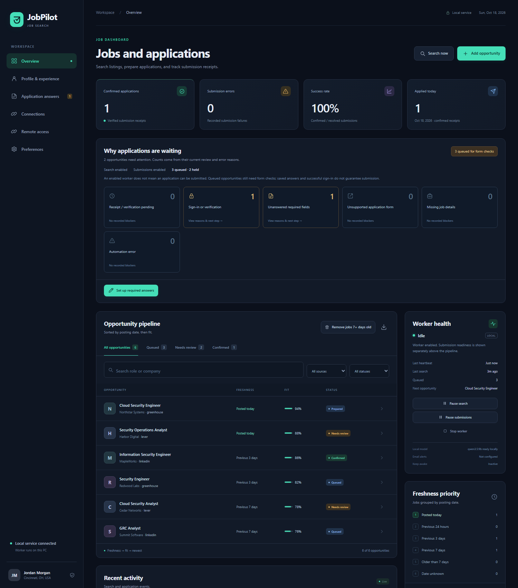

# JobPilot

[](https://github.com/abedabadoo/jobpilot/actions/workflows/ci.yml)
[](https://www.python.org/downloads/)
[](LICENSE)

JobPilot is a Windows job-search assistant. It finds opportunities, highlights job-description keywords, prepares tailored resumes and cover letters, and tracks the applications you submit yourself.



Dashboard shown with fictional example data.

## The workflow

1. Search job boards and public employer feeds, import a posting, or sync email alerts.
2. Open a role to see its fit score, description, keywords, and application documents.
3. Review the documents and open the original posting in your usual browser, using its saved sessions.
4. Click **Applied?** when you finish. The role moves from Opportunities to Applied.

Each opportunity also has **Review** and **Remove** controls. Removed jobs are excluded from later imports and searches. The Problems workspace records issues in plain language and links to the affected job.

Search and document preparation run locally and can continue while the dashboard is closed to the system tray. Opening a job link is independent of the document worker.

## Documents and keywords

The resume uses a single-column layout with readable type, clear section rules, aligned role headers, and PDF and Word exports. Cover letters use the role, employer, career history, and relevant job keywords. The role detail lists extracted tools and disciplines, including terms beyond the current profile's skill list.

JobPilot selects and rewrites relevant experience bullets, adds job terms, and removes less useful skills when tailoring a resume. Employer names, dates, education, and career achievements come from the saved profile. Interests stay beneath Skills & Certifications in every resume. Local Ollama handles tailoring and cover letters, with a deterministic fallback when the model is unavailable.

Document generation does not submit an application. Review and edit the exports before using them.

In a role's **Review** window, **Open** launches the PDF or Word file in your usual document app. **Download** saves a separate copy. The desktop window supports a save dialog; browser downloads use the browser's normal download settings.

## Gmail and email alerts

The Email workspace supports a read-only inbox connection, **Connect & test**, and **Sync now**, with the last check time, messages checked, job links found, and import counts. Credentials stay in Windows Credential Manager. Reading uses a read-only mailbox and `BODY.PEEK`, so messages are not marked read. A scan limit and date window keep each sync bounded; the interface reports when more messages exist than were checked.

For Gmail, use a Google app password with `imap.gmail.com` on port `993`. A normal Google account password is not suitable. See [email setup](docs/setup.md#email-alerts). EML alerts can also be imported without a persistent inbox connection.

## Requirements and setup

Use Windows and Python 3.13. The desktop window needs Microsoft Edge WebView2, and its launcher manages local Ollama for document preparation. Browser automation dependencies remain for dormant legacy modules and their regression tests.

```powershell
git clone https://github.com/abedabadoo/jobpilot.git
cd jobpilot
py -3.13 -m venv .venv
.\.venv\Scripts\python.exe -m pip install -e ".[dev,build]"
$env:JOBPILOT_DATA_DIR = Join-Path $env:LOCALAPPDATA 'JobPilot-Source\data'
.\.venv\Scripts\python.exe -m jobpilot.service --port 8765
```

Open `http://127.0.0.1:8765`. Replace the fictional starter profile before generating personal application documents. Search starts paused. Only run one installation or source instance at a time because the default service ports are shared.

[Windows setup](docs/setup.md) covers the desktop launcher, building, installation, email, and backups. See [architecture](docs/architecture.md), [development](docs/development.md), and [troubleshooting](docs/troubleshooting.md).

## Legacy features

Automatic application submission and remote access are dormant. The active assistant mode disables both, including for installations with older enabled settings. Their modules and regression tests remain in the repository, but the dashboard does not offer them as an application workflow.

## Data and license

Profiles, documents, inbox connection settings, and application history stay in the local data directory. Public job searches and inbox sync require internet access. Job pages open in your default browser.

Report vulnerabilities using [SECURITY.md](SECURITY.md). License terms are in [LICENSE](LICENSE); dependency attribution is in [THIRD_PARTY_NOTICES.md](THIRD_PARTY_NOTICES.md).
