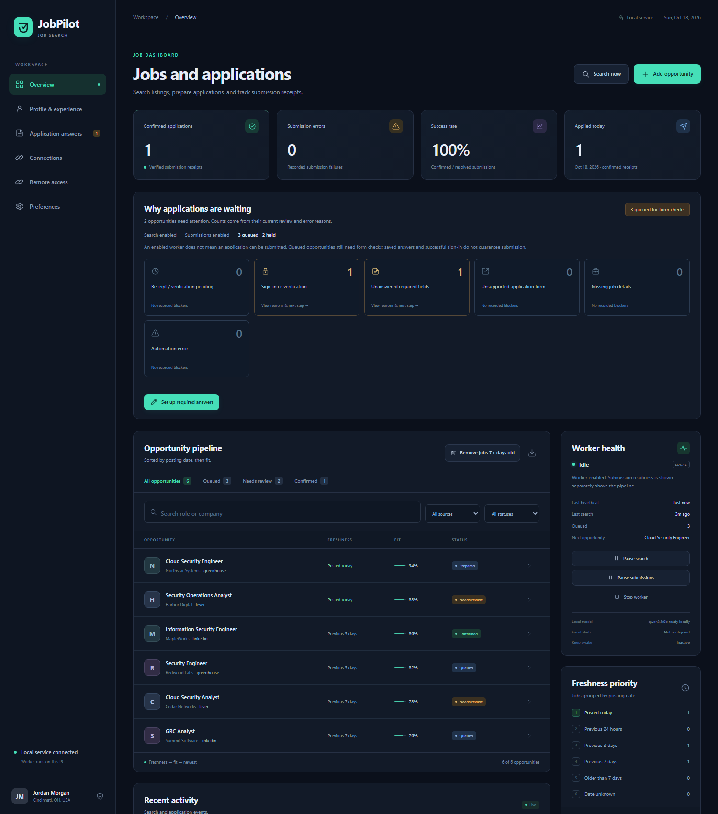

# JobPilot

[](https://github.com/abedabadoo/jobpilot/actions/workflows/ci.yml)
[](https://www.python.org/downloads/)
[](LICENSE)

JobPilot combines job discovery and ResumeForge in one Windows or Intel Mac application. It highlights job-description keywords, builds tailored resume PDFs, and tracks the applications you submit yourself. Its Chrome extension fills applications in your normal signed-in browser.



Dashboard shown with fictional example data.

## The workflow

1. Search job boards and public employer feeds, import a posting, or sync email alerts.
2. Roles scoring at least 80% start a ResumeForge resume build automatically. Open any role to review its fit score, keywords, and PDF.
3. Edit the resume in ResumeForge when needed. After a checked resume is ready, choose **Create cover letter…** there if you want one. Open the original posting in your usual browser.
4. Click **Applied?** when you finish. The role moves from Opportunities to Applied.

Each opportunity also has **Review** and **Remove** controls. Removed jobs are excluded from later imports and searches. The Problems workspace records issues in plain language and links to the affected job.

Search and ResumeForge resume preparation run locally and can continue after closing the dashboard. Windows offers system tray controls; macOS uses a native Cocoa window and menu. Opening a job link is independent of the document worker.
The opportunities list switches to cards in a narrow desktop window, so Review, Applied, and Remove remain visible on a 900 × 1440 portrait display.

Use **Start monitoring** above the opportunity list to keep checking automatically. Choose a check interval, or use **Search now** for a single check. The panel shows the next check, new opportunities, already saved jobs, filtered results, and each source's availability. Configured titles rotate through job-board searches in groups of eight, so roles beyond the first eight are checked on later passes. Each title is searched locally and remotely when enabled. The result limit applies to each role/location query. Source delays and rate limits can affect when a posting appears; limited sources pause while the others continue.

Greenhouse discovery scans a bundled directory of more than 5,000 employer boards in batches. Each pass reads lightweight board listings and fetches full descriptions for relevant titles published within 90 days. At a five-minute search interval, the full directory is revisited in roughly half an hour when the sources respond promptly. Boards named in search preferences are checked on every pass. The directory is based on the [CC0 open-jobs board list](https://github.com/elliottdehn/open-jobs/blob/main/slugs.json); it is a coverage starting point, not a claim that every employer is indexed. New Greenhouse links found in searches and alerts are added to the local board list for later checks.

Recent roles requesting roughly three years of experience appear ahead of fresh senior and lead roles. Within that group, newer postings and higher fit scores still lead. The posting date comes from the employer feed; updates to an older listing do not make it a new posting.

## Documents and keywords

ResumeForge owns all document creation. Its measured one-page layout keeps Interests beneath Skills & Certifications and lets you edit keywords and experience. JobPilot never creates a resume or cover letter. Once a role reaches 80% fit, JobPilot sends the complete posting to the bundled ResumeForge engine. ResumeForge performs its own contextual requirement analysis instead of treating JobPilot's quick dashboard keywords as reviewed priorities. A resume that needs review remains available in the editor for revision.

Checked automatic resumes are saved as `~/Downloads/JobPilot RF Docs/Company - Role/job-ID-hash/Alnajjar_Resume.pdf`, so separate postings with the same title never overwrite one another. Cover letters are never generated automatically. The editor offers an editable draft only after a checked resume exists; saving it creates `Alnajjar_CoverLetter.pdf` beside that posting's resume. JobPilot's **Sync ResumeForge PDFs** control adds the optional letter to the role. The Chrome extension attaches the prepared resume.

### ResumeForge handoff

Choose **ResumeForge profile** to edit your source resume or **Open in ResumeForge** on a role to edit that tailored draft. The existing ResumeForge profile is reused. Reopening a role keeps its edits; a changed posting starts a new workspace. The editor starts only when opened, so job monitoring does not keep Qt running in memory.

## Gmail and email alerts

The Email workspace supports a read-only inbox connection, **Connect & test**, and **Sync now**, with the last check time, messages checked, job links found, and import counts. Credentials use the operating system's credential vault (Windows Credential Manager or macOS Keychain). Reading uses a read-only mailbox and `BODY.PEEK`, so messages are not marked read. A scan limit and date window keep each sync bounded; the interface reports when more messages exist than were checked.

Each job in a digest keeps its own title, employer, and location. Alerts remain available for review when the full posting cannot be read, and a later sync can correct incomplete alert records. Email receipt time is kept separately from the posting date. Sync results distinguish new opportunities, already saved jobs, and alerts outside your preferences.

For Gmail, use a Google app password with `imap.gmail.com` on port `993`. A normal Google account password is not suitable. See [email setup](docs/setup.md#email-alerts). EML alerts can also be imported without a persistent inbox connection.

## Requirements and setup

Packaged desktop releases include their Python runtime. The combined Mac archive targets Intel (`x86_64`); see [Mac installation and source setup](docs/macos.md). Default Mac builds are ad hoc signed, without Apple notarization.

For Windows source development, use Python 3.13 and Microsoft Edge WebView2. ResumeForge can build with its offline provider or a model configured in the ResumeForge editor. The writing model is loaded only when ResumeForge needs it; JobPilot does not start a second model service. Browser automation dependencies are development-only support for dormant legacy regression tests.

```powershell
git clone https://github.com/abedabadoo/jobpilot.git
cd jobpilot
py -3.13 -m venv .venv
.\.venv\Scripts\python.exe -m pip install -e ".[dev,build]"
$env:JOBPILOT_DATA_DIR = Join-Path $env:LOCALAPPDATA 'JobPilot-Source\data'
.\.venv\Scripts\python.exe -m jobpilot.service --port 8765
```

Open `http://127.0.0.1:8765`. Replace the fictional starter profile before generating personal application documents. Search starts paused. Only run one installation or source instance at a time because the default service ports are shared.

[Windows setup](docs/setup.md) covers the desktop launcher, building, installation, email, and backups. See [Mac setup](docs/macos.md), [architecture](docs/architecture.md), [development](docs/development.md), and [troubleshooting](docs/troubleshooting.md).

## Chrome autofill

Extract `JobPilot-Autofill-1.0.0.zip`, open `chrome://extensions`, enable **Developer mode**, and choose **Load unpacked**. Select the `JobPilot-Autofill` folder containing `manifest.json`, then pin the extension. It works in your existing Chrome session on Windows or Mac.

Open **Profile & settings** to enter your information or import a profile JSON. To copy your saved JobPilot profile, click **Open JobPilot Settings**, generate a connection code in the dashboard, and paste it into the extension. The desktop app must be running for that import; the saved extension profile remains usable offline.

On an application page, click **Autofill this page**. Existing answers stay in place unless you enable replacement. **Attach resume** uploads the local or prepared resume you selected; **Undo last change** restores the previous values. The extension fills supported form controls and reports questions that need your answer. It never clicks Next or Submit. See the [extension guide](extension/README.md) for supported controls, connection revocation, and privacy details.

Build the extension ZIP with `python scripts/package_extension.py`. This uses an explicit runtime file list and excludes profiles, credentials, and test-only browser permissions. No Chrome Web Store account or JavaScript build service is needed for local installation.

## Legacy features

Automatic application submission and remote access are dormant. The active assistant mode disables both, including for installations with older enabled settings. Their modules and regression tests remain in the repository, but the dashboard does not offer them as an application workflow.

## Data and license

Profiles, documents, inbox connection settings, and application history stay in the local data directory. Public job searches and inbox sync require internet access. Job pages open in your default browser.

Report vulnerabilities using [SECURITY.md](SECURITY.md). License terms are in [LICENSE](LICENSE); dependency attribution is in [THIRD_PARTY_NOTICES.md](THIRD_PARTY_NOTICES.md).
