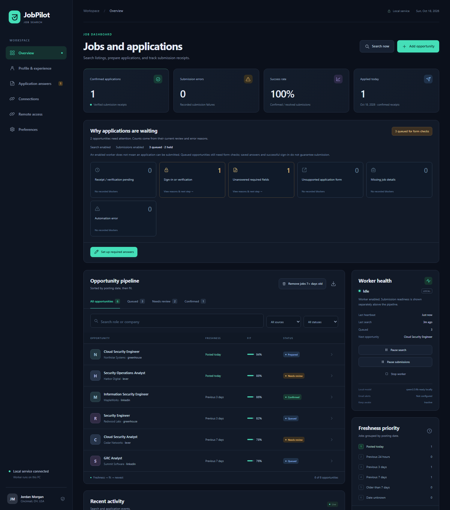

# JobPilot

[](https://github.com/abedabadoo/jobpilot/actions/workflows/ci.yml)
[](https://www.python.org/downloads/)
[](LICENSE)

JobPilot is a Windows and macOS job-search assistant. It finds opportunities, highlights job-description keywords, prepares tailored resumes and cover letters, and tracks the applications you submit yourself. Its Chrome extension fills applications in your normal signed-in browser.



Dashboard shown with fictional example data.

## The workflow

1. Search job boards and public employer feeds, import a posting, or sync email alerts.
2. Open a role to see its fit score, description, keywords, and application documents.
3. Review the documents and open the original posting in your usual browser, using its saved sessions.
4. Click **Applied?** when you finish. The role moves from Opportunities to Applied.

Each opportunity also has **Review** and **Remove** controls. Removed jobs are excluded from later imports and searches. The Problems workspace records issues in plain language and links to the affected job.

Search and document preparation run locally and can continue after closing the dashboard. Windows offers system tray controls; macOS uses a native Cocoa window and menu. Opening a job link is independent of the document worker.

Use **Start monitoring** above the opportunity list to keep checking automatically. Choose a check interval, or use **Search now** for a single check. The panel shows the next check, new opportunities, already saved jobs, filtered results, and each source's availability. Every configured role is searched locally and remotely when enabled. The result limit applies to each role/location query. Source delays and rate limits can affect when a posting appears; limited sources pause while the others continue.

## Documents and keywords

The resume uses a single-column layout with readable type, clear section rules, aligned role headers, and PDF and Word exports. Cover letters use the role, employer, career history, and relevant job keywords. The role detail lists extracted tools and disciplines, including terms beyond the current profile's skill list.

JobPilot selects and rewrites relevant experience bullets, adds job terms, and removes less useful skills when tailoring a resume. Employer names, dates, education, and career achievements come from the saved profile. Interests stay beneath Skills & Certifications in every resume. Local Ollama handles tailoring and cover letters, with a deterministic fallback when the model is unavailable.

Document generation does not submit an application. Review and edit the exports before using them.

In a role's **Review** window, **Open** launches the PDF or Word file in your usual document app. **Download** saves a separate copy. The desktop window supports a save dialog; browser downloads use the browser's normal download settings.

## Gmail and email alerts

The Email workspace supports a read-only inbox connection, **Connect & test**, and **Sync now**, with the last check time, messages checked, job links found, and import counts. Credentials use the operating system's credential vault (Windows Credential Manager or macOS Keychain). Reading uses a read-only mailbox and `BODY.PEEK`, so messages are not marked read. A scan limit and date window keep each sync bounded; the interface reports when more messages exist than were checked.

Each job in a digest keeps its own title, employer, and location. Alerts remain available for review when the full posting cannot be read, and a later sync can correct incomplete alert records. Email receipt time is kept separately from the posting date. Sync results distinguish new opportunities, already saved jobs, and alerts outside your preferences.

For Gmail, use a Google app password with `imap.gmail.com` on port `993`. A normal Google account password is not suitable. See [email setup](docs/setup.md#email-alerts). EML alerts can also be imported without a persistent inbox connection.

## Requirements and setup

Packaged desktop releases include their Python runtime. Choose the native Mac archive for Apple Silicon (`arm64`) or Intel (`x86_64`); see [Mac installation and source setup](docs/macos.md). Default Mac builds are ad hoc signed, without Apple notarization.

For Windows source development, use Python 3.13 and Microsoft Edge WebView2. The launcher can manage local Ollama for document preparation. Browser automation dependencies remain for dormant legacy modules and their regression tests.

```powershell
git clone https://github.com/abedabadoo/jobpilot.git
cd jobpilot
py -3.13 -m venv .venv
.\.venv\Scripts\python.exe -m pip install -e ".[dev,build]"
$env:JOBPILOT_DATA_DIR = Join-Path $env:LOCALAPPDATA 'JobPilot-Source\data'
.\.venv\Scripts\python.exe -m jobpilot.service --port 8765
```

Open `http://127.0.0.1:8765`. Replace the fictional starter profile before generating personal application documents. Search starts paused. Only run one installation or source instance at a time because the default service ports are shared.

[Windows setup](docs/setup.md) covers the desktop launcher, building, installation, email, and backups. See [Mac setup](docs/macos.md), [architecture](docs/architecture.md), [development](docs/development.md), and [troubleshooting](docs/troubleshooting.md).

## Chrome autofill

Extract `JobPilot-Autofill-1.0.0.zip`, open `chrome://extensions`, enable **Developer mode**, and choose **Load unpacked**. Select the `JobPilot-Autofill` folder containing `manifest.json`, then pin the extension. It works in your existing Chrome session on Windows or Mac.

Open **Profile & settings** to enter your information or import a profile JSON. To copy your saved JobPilot profile, click **Open JobPilot Settings**, generate a connection code in the dashboard, and paste it into the extension. The desktop app must be running for that import; the saved extension profile remains usable offline.

On an application page, click **Autofill this page**. Existing answers stay in place unless you enable replacement. **Attach resume** uploads the local or prepared resume you selected; **Undo last change** restores the previous values. The extension fills supported form controls and reports questions that need your answer. It never clicks Next or Submit. See the [extension guide](extension/README.md) for supported controls, connection revocation, and privacy details.

Build the extension ZIP with `python scripts/package_extension.py`. This uses an explicit runtime file list and excludes profiles, credentials, and test-only browser permissions. No Chrome Web Store account or JavaScript build service is needed for local installation.

## Legacy features

Automatic application submission and remote access are dormant. The active assistant mode disables both, including for installations with older enabled settings. Their modules and regression tests remain in the repository, but the dashboard does not offer them as an application workflow.

## Data and license

Profiles, documents, inbox connection settings, and application history stay in the local data directory. Public job searches and inbox sync require internet access. Job pages open in your default browser.

Report vulnerabilities using [SECURITY.md](SECURITY.md). License terms are in [LICENSE](LICENSE); dependency attribution is in [THIRD_PARTY_NOTICES.md](THIRD_PARTY_NOTICES.md).
